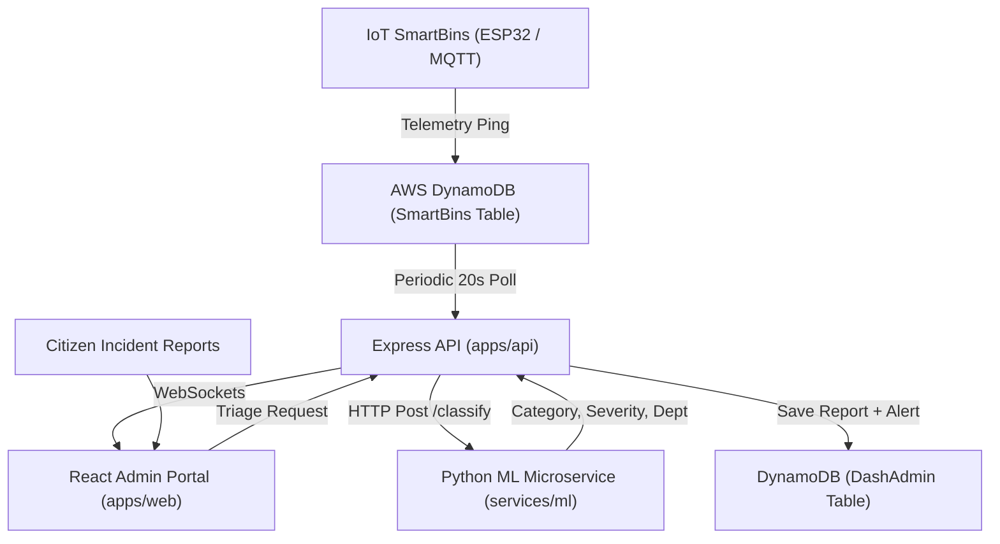

# GarbageGuardian — System Architecture & Monorepo Guide

Welcome to the **GarbageGuardian** Smart City IoT & Waste Operations Monorepo.

---

## 1. Monorepo Structure

```text
Admin_GC/
├── package.json               # Root workspace configuration
├── package-lock.json
├── .gitignore                 # Unified repository gitignore
├── docs/                      # Team documentation & progress logs
│   ├── ARCHITECTURE.md        # System architecture overview
│   ├── TEAM_PROGRESS.md       # Engineering milestones & changelog
│   └── GETTING_STARTED.md     # Quickstart setup guide for teammates
├── apps/
│   ├── web/                   # Vite + React + Tailwind Frontend (Port 5173)
│   └── api/                   # Node.js + Express + DynamoDB API (Port 5000)
└── services/
    └── ml/                    # Python Flask + Scikit-Learn Classifier (Port 5001)
```

---

## 2. Service Overview & Ports

| Service | Directory | Tech Stack | Port | Purpose |
| :--- | :--- | :--- | :--- | :--- |
| **Web** | `apps/web/` | React 18, Vite, Tailwind CSS, Recharts | `5173` | Admin dashboard, live map, incident triage |
| **API** | `apps/api/` | Express.js, AWS SDK v3, Socket.io | `5000` | REST API, IoT sync, DynamoDB access, WebSockets |
| **ML** | `services/ml/` | Python 3, Flask, Scikit-Learn | `5001` | NLP incident classifier & automated severity triage |

---

## 3. Data Flow & Communication



---

## 4. Database Tables (AWS DynamoDB)

* **`GarbageGuardianDashAdmin`**: Admin credentials, event-driven alert notifications, and incident logs.
* **`SmartBins`**: Real-time snapshot of bin hardware (fill percentage, temperature, battery, location).
* **`GarbageGuardianReports`**: Citizen complaints and hazard reports with AI classifications.
* **`GarbageGuardianTasks`**: Waste collection and maintenance jobs assigned to employees.
* **`GarbageGuardianUsers`**: Staff and collector roster.

---

## 5. Root NPM Commands

From the repository root (`/home/rehant/Admin_GC`):

```bash
# Development
npm run dev:web     # Start Vite frontend
npm run dev:api     # Start Express backend API
npm run dev:ml      # Start Python ML microservice

# Testing & Builds
npm run test:web    # Run frontend unit & chart test suite
npm run build:web   # Build production frontend bundle
npm run train:ml    # Re-train NLP classifier on holdout dataset
```
